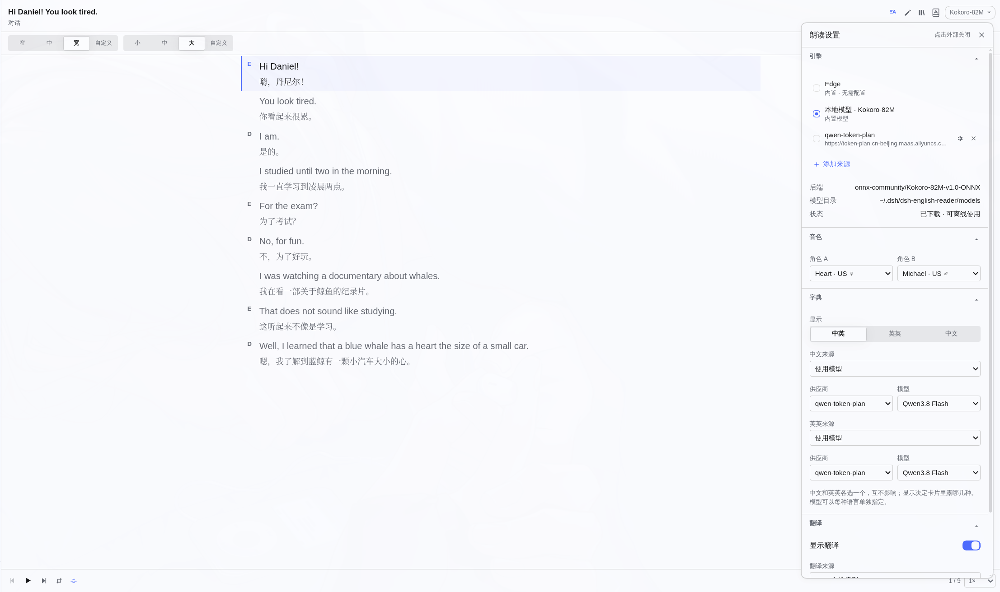
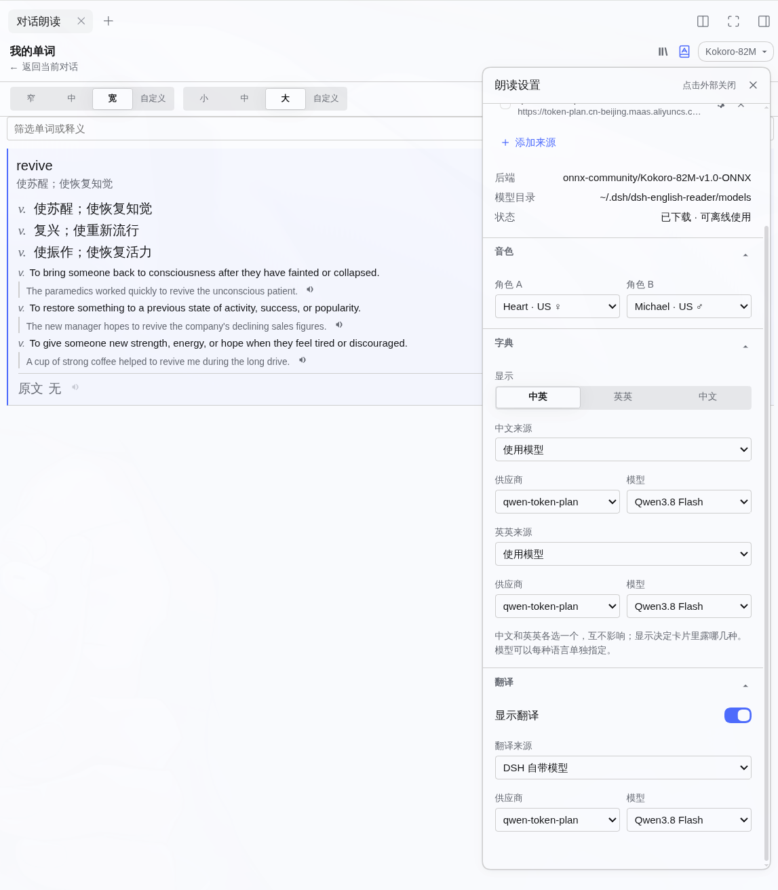

<div align="center">


# dsh-english-reader

**Read English aloud inside DeepSeek Harness: paste a text, follow it sentence by sentence, and pick up exactly where you stopped.**

A tab in the right sidebar, or a full page in the side panel. Word-level highlighting, sentence translation, Edge online and local Kokoro engines, and your own TTS API if you have one.

[中文](README.md) · [English](README.en.md)

<a href="LICENSE"></a>
<a href="https://github.com/deepseek-ai/deepseek-harness"></a>

</div>

## Why

Reading English long-form splits your attention: the audio is on sentence 12 while your eyes are on sentence 30, and coming back loses both.

This plugin ties "what is spoken" to "what is read": sentence-level seeking, word-level highlighting, persisted progress. Close the panel, restart Harness — you land on the same sentence.

It handles both shapes: a hard-wrapped **article** is joined into sentences instead of being split mid-thought, and a labelled **dialogue** (`Emma: Hi` / `Daniel: Hello`) is detected and read by two alternating voices.

<p align="center">
  
</p>

<br clear="all">

## Features

- **Two entry points**: a right-sidebar tab, or a full-width side panel (no composer in the way).
- **Sentence playback with resume**: click any sentence to start there; progress is persisted.
- **Word-level highlight**: Edge reports **real word timestamps**, so the current word tracks the audio. The local engine estimates.
- **Sentence translation**: a model you already configured in Harness, or a keyless service (Google, Volcengine).
- **Article vs dialogue**: hard wraps are joined, paragraphs split on blank lines, two voices only when two speakers are actually detected.
- **Dialogue library**: keep many texts, rename, pin, delete; each row shows "sentence n of m".
- **Loop and continuous playback**: looping one sentence and "continue to the next" are separate switches.
- **Right-click a word**: only the sentence being read splits into words; hovering outlines them, right-click opens the definition.
- **Chinese and English dictionaries**: Chinese meanings grouped by part of speech, English definitions with examples, or a model-written definition.
- **Saved words**: save from the card, reach the list from the header, and expand an entry in place with its examples and source sentence.
- **Reading width and type size**: narrow / medium / wide / custom, three type presets plus an exact pixel size, shared by the reader, the library and the saved words.

The settings card has four collapsible sections; only the engine starts open, and the ones you expand are remembered.

## Install

**From npm (recommended)**

In DSH **Plugins → Add plugin**, enter:

```
dsh-english-reader
```

Or `dsh plugin --profile web add dsh-english-reader`.

**From GitHub**: enter `github:KNtnx/dsh-english-reader`.

**From a local checkout**:

```bash
git clone https://github.com/KNtnx/dsh-english-reader.git
dsh plugin --profile web add link:./dsh-english-reader
```

Replace `web` with your profile (Desktop builds usually use `desktop`), then restart `dsh web`.

> The Edge voices work as soon as the plugin is installed. For the local model, press **Download and use** on the local-model card: the plugin installs the engine (about 120 MB, once) and then downloads the model (about 89 MB). Edge-only users install neither.

## Speech sources

Edge is built in; the rest you add from the panel. Each source can be named, edited and removed.

| Source | Needs | Notes |
| --- | --- | --- |
| Microsoft Edge (online) | nothing | Neural voices, needs a network. The best word-highlighting comes from it |
| Local model (Kokoro-82M) | ~120 MB engine + 89 MB model | Installed by **Download and use**; you can also point at an existing model directory (`config.json` and `onnx/`) |
| Custom TTS API | URL, protocol, model, key | OpenAI-compatible, Alibaba Bailian or Azure; enter the host and the path is discovered and remembered |

## Dictionaries

Three independent choices:

- **Show**: both / English only / Chinese only
- **Chinese source**: iciba (free) or a model
- **English source**: WordNet (free), Wiktionary (free), Collins (needs a key), or a model

Choosing a model reveals the provider and model right below it; the two languages can use different models. Only the shown language is fetched, so English-only mode costs no Chinese lookup.

| Source | Language | Needs | Notes |
| --- | --- | --- | --- |
| iciba | Chinese | nothing | Senses grouped by part of speech; phrases work too |
| WordNet (Datamuse) | English | nothing | Full-sentence definitions, clear part-of-speech labels |
| Wiktionary | English | nothing | A backup beside WordNet |
| Collins | English | your own API key | Official API; the key stays on this machine |
| Model | both | a DSH model | Collins-style full-sentence definition, IPA, Chinese, examples |

Model definitions are whole sentences (`To regulate an activity means to control it by means of official rules.`), not synonym piles. Each word's model definition is generated once, so switching language or source does not spend quota again.

Lookups are limited to **the sentence being read**: the rest of the text stays plain, so a long text costs no more than a short one.

## Saved words

- Click a row to **expand it in place**: Chinese by part of speech, English definitions with examples, then the sentence it came from.
- The expansion **follows the current dictionary**: switching source or shown language re-resolves it.
- Only the **word and its sentence** are stored; definitions come from the dictionary or its cache.
- Three speakers: the word, each English example, and the source sentence. A word saved from the lookup card has no sentence, so that speaker is greyed out.
- Both the saved-words page and the library return to the open dialogue in one click, and both share the reader's width and size controls.
- **Shared across conversations**: the library, the reading positions and the saved words live on the host, so every conversation and every browser opens the same list.

<p align="center">
  
</p>

## The model tool (`english_reader`)

A conversation can read and edit this library without you opening the panel: list the words and dialogues, filter them by folder, add words, retitle or delete a dialogue, switch the dictionary — all through one tool.

- **File by name**: `folder` takes a name (`25.12.1`) and makes it when it is new; `folderId` takes one from `list_folders`, and a wrong id is an error that lists the folders there are.
- **Batches**: `add_words`, `move_words` and `remove_words` take a list, so filing ten words is one call rather than ten.
- **One change per call**, reads apart from writes, so a listing tells the id before it is needed.
- **No reload needed**: what a tool writes appears in an open panel by itself.

## Translation sources

| Source | Needs | Notes |
| --- | --- | --- |
| Harness model | a configured provider and model | Reuses what Harness already has; the best quality |
| Google | nothing | Keyless `translate.googleapis.com` |
| Volcengine | nothing | Keyless web endpoint; reads more naturally in Chinese |

Switching source (or model) re-translates and replaces the lines on screen instead of leaving the previous source's version in place.

## Privacy

- Text is synthesized only by the engine you pick: the local model stays offline, Edge and custom APIs send the sentence to that vendor.
- A lookup sends only the word you right-clicked, never the whole text.
- API keys stay on this machine and are never sent to the browser.
- The library, reading positions, saved words and settings stay on this machine and are not uploaded.

## Updating

- **Plugin page**: press **Update to x.y.z**.
- **Panel**: the version row at the bottom of **Settings → Engine**, then **Check for updates → Update now**.
- **Local checkout**: `git pull` in that directory, then restart DSH.

## Uninstalling

Removing the plugin removes the code; your data stays for the next install:

| What | After removal |
| --- | --- |
| Words, dialogues, folders, reading positions, speech sources and keys, dictionary settings | **kept** |
| The local model (~113 MB) and the engine packages (~120 MB) | **deleted**, reinstalled by the next download |

To keep a copy first, copy `$DSH_HOME/dsh-english-reader/` somewhere else.

## Troubleshooting

| Symptom | Fix |
| --- | --- |
| Blank panel | Restart `dsh web`; if it persists, check the browser console |
| The local engine will not install | Run the command under **Installing the local engine manually** below in the profile directory, then restart |
| The local model stays "not downloaded" | Press Download and wait for 100% |
| Custom API returns 400 / 401 | Use **Test** in the editor — it names the path and the original response; 401 means the vendor rejected the key |
| Adding the plugin by name finds nothing | Switch the install source to the official npm registry, or enter `https://registry.npmjs.org/` under **Custom registry** |
| A voice is ignored | Some vendors silently fall back on unknown voices; try a source that reports errors |
| Word highlight does not move | Only Edge reports word timestamps; other sources estimate from length |
| A lookup always says nothing was found | Dictionaries need a network; an unusual phrase falls back to translation |
| A saved word says "none" for its sentence | Words saved from the dictionary card have no source sentence, by design |

### Installing the local engine manually

In the profile directory (`$DSH_HOME/profiles/web` or similar):

```bash
pnpm add --ignore-scripts kokoro-js@^1.2.1
```

Restart `dsh web`, then press **Download and use** in the panel to fetch the model.

## Development

Read [AGENTS.md](AGENTS.md) first: it is a directory of module docs under `docs/modules/`, one page per thing you might change. Read that page's invariants before coding and write them back after.

```bash
npm install     # react, react-dom, jsdom
npm test        # the whole suite, about three seconds
```

What the tests cover and how to check in a browser: [testing notes](docs/TESTING.md).

## License

MIT, unless stated otherwise. See [LICENSE](LICENSE).