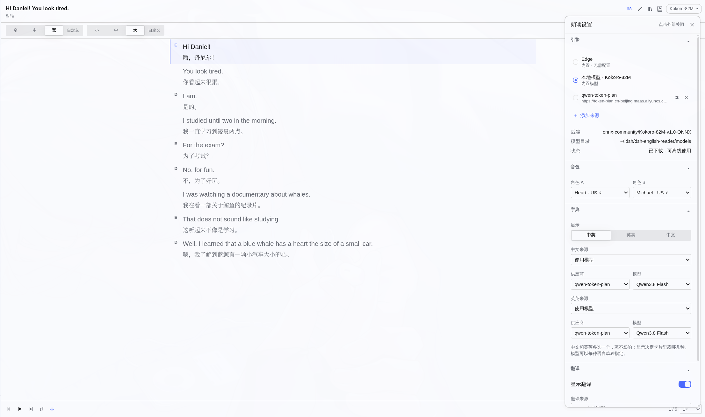

<div align="center">


# dsh-english-reader

**在 DeepSeek Harness 里朗读英语：粘贴一段文字，逐句跟读，随时从上次停下的地方继续。**

右侧栏一个标签页，或侧栏一个整页面板。逐词高亮、逐句翻译、Edge 在线与本地 Kokoro 两种引擎，还能接你自己的 TTS API。

[中文](README.md) · [English](README.en.md)

<a href="LICENSE"></a>
<a href="https://github.com/deepseek-ai/deepseek-harness"></a>

</div>

## 为什么需要它

读英语长文时，语音合成和阅读位置是两件事：播放器在读第 12 句，你的眼睛在第 30 句，切换回来就找不着了。

这个插件把「念到哪」和「看到哪」绑在一起：句子级定位、词级高亮、进度持久化。关掉面板、重启 Harness，回来还是那一句。

他同时照顾两件事：**文章和对话**。粘贴一篇硬换行的文章不会被拆成乱句；粘贴 `Emma: Hi` / `Daniel: Hello` 这样的对话，会自动识别两个说话人并用两套音色轮流读。

<p align="center">
  
</p>

<br clear="all">

## 功能

- **两种打开方式**：右侧栏标签页，或侧栏整页面板（全宽，无输入框打扰）。
- **逐句朗读 + 断点续读**：点任意一句从那里念；进度写进存储，重开即恢复。
- **逐词高亮**：Edge 引擎报告**真实词时间戳**，当前词随语音走；本地引擎按时长估算。
- **逐句翻译**：三种来源任选——DSH 已配置的模型、免密钥的 Google、免密钥的火山翻译；译文用衬线体、次级色，与原文区分。
- **文章 / 对话自动判别**：硬换行合并成句，段落按空行切分；识别到两个人名才用双音色。
- **对话库**：保存多篇文本，可重命名、置顶、删除，列表里显示「第几句 / 共几句」。
- **连读与循环**：单句循环和「连读下一句」各自独立，关掉连读就一句一停，停在原处。
- **右键查词**：只有正在朗读的那一句把单词拆成词级；悬停出现淡框，右键弹出释义。
- **中英 / 英英 / 模型词典**：中文按词性分行，英文来自 WordNet，也可以让 DSH 模型自己写（柯林斯式整句释义）。
- **单词收藏**：词卡可收藏，头部入口进入「我的单词」，点一行在原地展开词条、例句和收藏时的原句。
- **阅读宽度与字号**：窄 / 中 / 宽 / 自定义，字号小 / 中 / 大 + 自定义 px；阅读页、对话库、我的单词三处共用。

设置卡片分四块，可折叠，只默认展开「引擎」，你展开过的会记住；一次只展开需要的部分，卡片不会撑出屏幕。

## 安装

**方式一：从 GitHub 安装（推荐）**

在 DSH 的 **插件 → 添加插件** 里填：

```
github:KNtnx/dsh-english-reader
```

或命令行：

```bash
dsh plugin --profile web add github:KNtnx/dsh-english-reader
```

**方式二：本地目录**

```bash
git clone https://github.com/KNtnx/dsh-english-reader.git
dsh plugin --profile web add link:./dsh-english-reader
```

把 `web` 换成你实际的 profile（Desktop 版通常是 `desktop`）。安装完重启 `dsh web`。

> 插件带两个运行时依赖（`msedge-tts`、`kokoro-js`），通常随安装一起装好。若面板报「引擎不可用」，进插件目录执行一次 `npm install --omit=dev` 再重启。

## 语音来源

内置 Edge，其余来源由你添加（侧栏面板 → 添加来源）。每个来源可以命名、编辑设置、单独删除。

| 来源 | 需要 | 说明 |
| --- | --- | --- |
| 微软 Edge（在线） | 什么都不用 | 神经音色，需要联网，文本发送到微软。首选的「逐词高亮」体验来自它。 |
| 本地模型（Kokoro-82M） | 下载 89 MB | 在本机跑，可离线；也可指向你已有的模型目录（含 `config.json` 与 `onnx/`）。 |
| 自定义 TTS API | 地址、协议、模型、密钥 | 三种协议：OpenAI 兼容 `/audio/speech`、阿里云百炼原生接口、Azure 语音（SSML）。只填域名即可，路径会自动探测并记住。 |

**为什么协议是必选项**：同一家服务的不同接口路径和请求体完全不同。阿里云百炼的 OpenAI 兼容前缀只支持对话与向量，语音合成走原生的 `api/v1/services/audio/tts/SpeechSynthesizer`，返回的还是音频下载地址。协议决定发什么请求。

**密钥不出宿主**：面板只能读到 `hasKey: true`，读不到明文。语音来源存在 `sources.json`，柯林斯密钥存在 `dictionary.json`（都在 `$DSH_HOME/dsh-english-reader/`，权限 `0600`）；测试连接、拉列表、查词典都由宿主代取密钥。

## 词典

三个独立选项，互不影响：

**显示**：中英 / 英英 / 中文 —— 决定卡片里露出哪几种释义

**中文来源**：iciba（免费）/ 使用模型

**英英来源**：WordNet（免费）/ Wiktionary（免费）/ 柯林斯（需密钥）/ 使用模型

选「使用模型」时，**对应的供应商与模型就在它下面展开**，两种语言可以指定不同的模型。只查询正在显示的语言，所以「英英」模式不会多花一次中文查询。

| 来源 | 语言 | 需要 | 说明 |
| --- | --- | --- | --- |
| iciba | 中文 | 无 | 按词性分行，词组同样可查 |
| WordNet（Datamuse） | 英文 | 无 | 完整句子释义，词性标记清晰 |
| Wiktionary | 英文 | 无 | WordNet 之外的备份 |
| 柯林斯 | 英文 | **自己的 API key** | 官方接口；密钥存在宿主机 `$DSH_HOME/dsh-english-reader/dictionary.json`（权限 `0600`），浏览器只能读到「已保存」 |
| 使用模型 | 中英 | DSH 模型 | 柯林斯式整句释义 + IPA + 中文 + 例句 |

模型写出的释义是完整句子（例如 `To regulate an activity means to control it by means of official rules.`），而不是同义词堆砌。**每个词的模型释义只生成一次**，结果按 `单词|来源|模型` 缓存，切换显示语言、来源或模型都不会重复消耗额度；两个来源都没有词条时（多为生僻词组），才回落到翻译来源。

查词只对**当前朗读句**开放：其余句子是纯文本，长文的渲染开销不随句数增长。

## 我的单词

- 点一行**就地展开**：中文按词性分行，英文释义带例句，末尾附收藏时的原句。
- 展开的内容**跟随当前词典**：换来源或换显示语言，展开区立刻重新解析，不会停留在收藏时的旧释义。
- 收藏只记录**单词和原句**，释义来自词典或缓存——所以同一个词在「英英」下看是 WordNet，在「中文」下看是 iciba。
- 三个喇叭：单词、词条例句、原句各一个；从字典卡片搜来的词没有原句，那个喇叭是灰的。
- 「我的单词」和「对话库」都可一键返回当前对话；两页共用阅读页的宽度与字号设置。
- **跨会话共享**：对话库、朗读位置和收藏的单词存在宿主（`library.json`）里，不是某个浏览器的本地存储——所以每个对话、每个浏览器打开都是同一份。

<p align="center">
  
</p>

## 模型工具（`english_reader`）

对话里的模型可以直接读写这份库，不需要你打开面板：查有哪些词和文章、按夹子筛选、加词、改标题、删词、换词典，都走同一个工具。

- **按名字归类**：`folder` 收夹名（如 `25.12.1`），没有就顺手建出来；`folderId` 收 `list_folders` 给的 id，给错会报错并列出已有的夹子。
- **批量**：`add_words` / `move_words` / `remove_words` 一次处理一批词，十个词是一次调用，不是十次。
- **一次只改一件事**：读（`list_words`、`list_folders`、`list_dialogues`、`get_settings`、`define_word`）与写（`add_*`、`move_*`、`rename_dialogue`、`delete_dialogue`、`set_dictionary`、`normalize_words`）分开，写之前先列一次就知道 id。
- **归类不会被覆盖**：夹子归属由「谁最后一次移动」的时间戳决定，浏览器、另一个面板、工具三方写同一份文件也不会互相抹掉。
- **改完立刻生效**：面板每两秒问一次宿主的版本号（隐藏时暂停），工具刚写进去的词会自己出现在列表里，不用刷新页面。

## 翻译来源

| 来源 | 需要 | 说明 |
| --- | --- | --- |
| DSH 自带模型 | 选择供应商与模型 | 用你在 Harness 里已经配置好的模型，译文质量最好 |
| Google | 无 | 免密钥的 `translate.googleapis.com` |
| 火山翻译 | 无 | 免密钥的网页接口，中文语感更自然 |

译文跟着**来源**走：每条译文都记着是哪个来源、哪个模型生成的，换来源（或换模型）会立刻重新翻译并替换屏幕上的译文，不会继续显示旧来源的版本。

## 隐私

- 文本只在你选择的引擎上合成：本地模型完全离线，Edge 与自定义 API 会把句子发给对应服务商。
- 查词时只有你查的那个单词会发给词典来源（iciba / Wiktionary），不会上传整篇文本。
- API 密钥只存宿主，不以任何形式下发到浏览器，也不写进前端存储。
- 本机模型、来源配置与对话库分别在 `$DSH_HOME/dsh-english-reader/models/`、`sources.json` 与 `library.json`，不上传。
- 翻译与语音请求只从宿主发起，面板不直连第三方。

## 排错

| 现象 | 处理 |
| --- | --- |
| 面板一片空白 | 打开浏览器控制台看报错；多半是插件客户端没加载，重启 `dsh web` |
| 「引擎不可用」 | 插件依赖没装：进插件目录 `npm install --omit=dev` |
| 本地模型一直「未下载」 | 点「下载」等进度到 100%；模型在 `$DSH_HOME/dsh-english-reader/models/` |
| 自定义 API 报 400 / 401 | 先在编辑窗口点「测试连接」，它会显示具体路径与原始响应；401 表示密钥被服务商拒绝 |
| 音色填了却不生效 | 换一个能连通的来源再试；部分服务商对未知音色是静默回退而不是报错 |
| 逐词高亮不动 | 只有 Edge 引擎报告词时间戳，其余来源按字符长度估算 |
| 查词一直「没查到」 | 词典需要联网；先在设置里确认字典档位，词组查不到是正常的，会走翻译来源 |
| 收藏的单词原文显示「无」 | 从字典卡片搜索收藏的词没有来源句，这是预期行为 |

## 开发

```bash
npm install                       # 一次：react、react-dom、jsdom 是开发依赖
npm test                          # 全部测试，约一秒
node --check index.js client.js worker.mjs
dsh plugin --profile web add link:$(pwd)
```

测试会在 jsdom 里挂载真正的面板并点击真正的控件——之前漏掉的问题，几乎都是两个操作同时写同一份状态。覆盖了什么、故意没覆盖什么（排版、音频、真实网络），以及遇到 bug 时怎么写测试，见 [测试流程（含浏览器复核）](docs/TESTING.zh.md) 与 [docs/TESTING.md](docs/TESTING.md)。

```
package.json        插件清单（dsh.bundle.patch + dsh.client）
cordis.patch.yml    宿主行插入
index.js            宿主：路由、来源存储、四种翻译、两族 TTS 协议
worker.mjs          子进程：Edge 与 Kokoro 引擎，词边界解析
client.js           浏览器：阅读面板、设置卡片、添加来源对话框、词高亮
locale/             插件市场展示文案
docs/DETAIL.md      插件详情页（英文）
docs/DETAIL.zh.md   插件详情页（中文）
```

## License

除特别说明外，本仓库以 [MIT](LICENSE) 授权。
